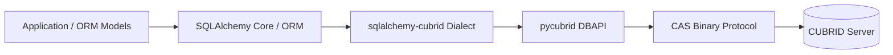
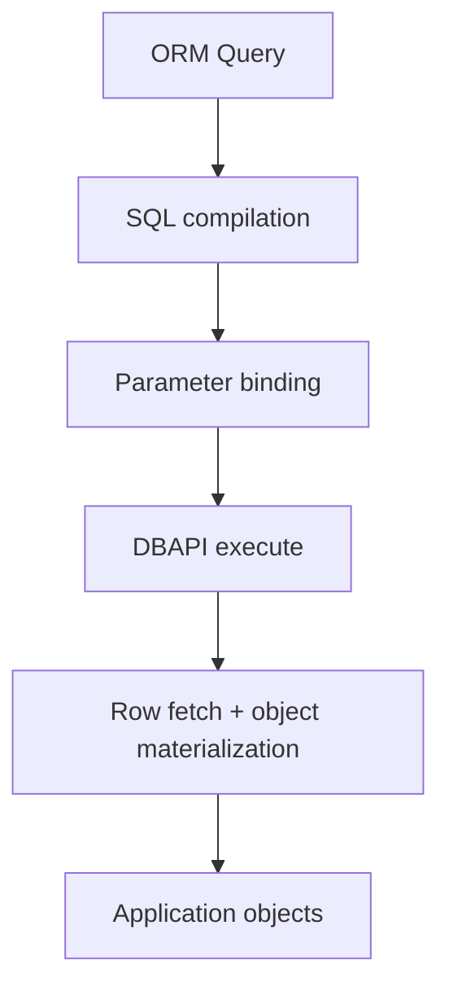
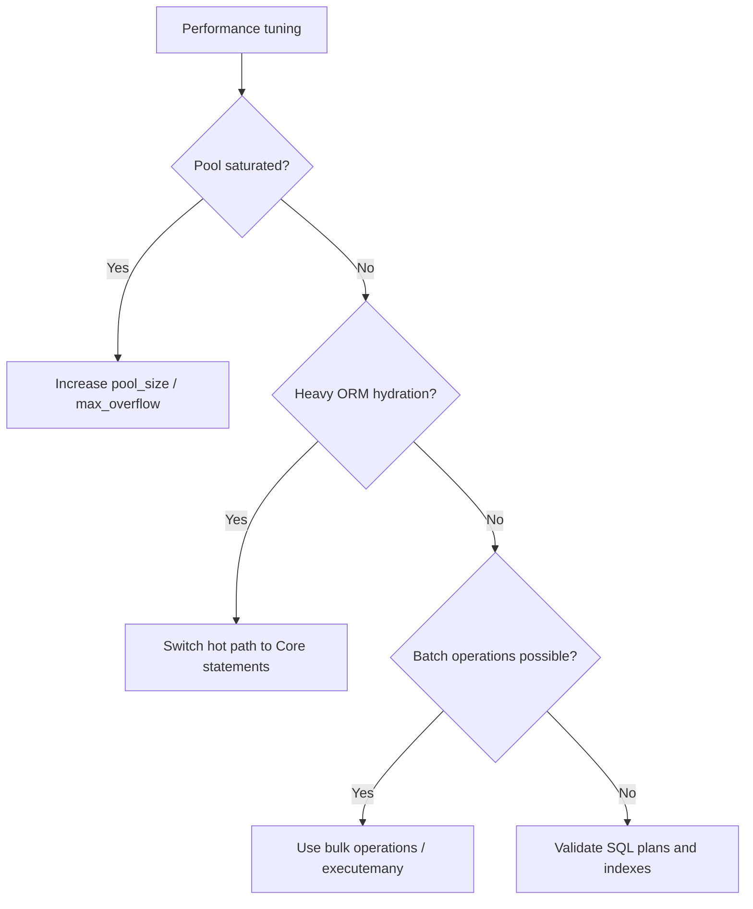

# Performance Guide

This guide explains where time goes when an application uses `sqlalchemy-cubrid`,
how to keep common workloads fast, and how to measure the dialect on your own
machine. It does not publish benchmark numbers: reproducible performance
experiments across drivers and databases live in
[cubrid-benchmark](https://github.com/cubrid-lab/cubrid-benchmark).

---

## Table of Contents

- [Overview](#overview)
- [Performance Characteristics](#performance-characteristics)
- [Optimization Tips](#optimization-tips)
- [Known Limitations](#known-limitations)
- [Measuring Locally](#measuring-locally)

---

## Overview

`sqlalchemy-cubrid` adds SQLAlchemy Core/ORM behavior on top of the CUBRID Python driver.





---

## Performance Characteristics

- The dialect inherits the driver's transport behavior and the CAS protocol's
  round-trip costs. For committed single-row writes the server round trip and
  the commit dominate the elapsed time; for reads, the SQLAlchemy and ORM
  layers add a measurable share.
- SQL compilation is fast but not free. SQLAlchemy's statement cache (on by
  default) reuses compiled statements, so repeated statements of the same shape
  skip compilation; turning the cache off (`execution_options(compiled_cache=None)`, or
  `query_cache_size=0` on the engine) adds the compilation cost to every
  execution.
- The ORM adds identity-map and object-materialization costs compared with Core
  or raw DB-API usage; the difference grows with the number of rows loaded.
- Core and ORM bulk INSERTs of a parameter list use SQLAlchemy's
  insertmanyvalues feature: a few multi-row `INSERT ... VALUES` statements
  instead of one statement per row. An INSERT into a column whose type has a
  `bind_expression()` falls back to the driver's `executemany()`.
- With pycubrid (sync and async), Core UPDATE and DELETE parameter lists go
  through the driver's `executemany()`, so they cost about the same as a raw
  `executemany()` call. CUBRIDdb is different; see Known Limitations.
- Profiling of the dialect on 2026-10-12 (sqlalchemy-cubrid 1.11.0, pycubrid
  1.12.0, CUBRID 11.4) found no dialect-specific hotspot: the dialect's own
  modules took a negligible share of request time, and most time was spent in
  SQLAlchemy, the driver and waiting for the server. Re-measure before relying
  on this for other versions.

---

## Optimization Tips

- Configure pooling explicitly (for example `pool_size`, `max_overflow` and
  `pool_pre_ping=True`) and size the pool for the number of concurrent workers.
- Keep the statement cache on, and prefer statements whose shape does not change
  from call to call, so SQLAlchemy can reuse the compiled form.
- Send many rows in one call: pass a list of parameter dictionaries to Core
  `insert()`, or use ORM bulk INSERT/UPDATE, instead of one statement per row.
- Keep transactions explicit and group related writes; every commit costs a
  server round trip.
- Use Core, or load only the columns you need, when you do not need ORM objects.



---

## Known Limitations

- **CUBRIDdb and threads.** The CUBRIDdb C extension (checked in the
  cubrid-python v11.3.0.51 source, which has no `Py_BEGIN_ALLOW_THREADS`; not
  verified for the 9.3.0 line) holds Python's global interpreter lock during server round trips, so several threads in one
  process do not run queries in parallel through it. A measurement on
  2026-10-13 with the cubrid-python v11.3.0.51 build showed no throughput gain
  from 4 or 8 threads. Multi-threaded applications should use pycubrid.
- **Batch UPDATE and DELETE on CUBRIDdb.** On the CUBRIDdb driver the dialect
  sends a Core UPDATE/DELETE parameter list as one `execute()` per row, because
  that driver's `executemany()` does not bind `None` (a row silently reuses the
  previous row's value) and its `rowcount` reports only the last row. Each row is a separate server round
  trip, and this path cannot use pycubrid's batch or prepared paths.
- **Prepared batches are not the default.** pycubrid has an opt-in
  `executemany(..., prepared=True)` that was faster for large batches in local
  measurements, but it accepts a narrower set of values and rejects statements
  that start with `WITH`. The dialect keeps the driver's default batch path.
- **Reflection sends several statements per table.** Reflecting a table's
  columns, keys, indexes and constraints issues several CUBRID catalog queries,
  so reflect only the tables you need on large schemas.
- **Async adds a bridge.** `cubrid+aiopycubrid://` runs SQLAlchemy's async API
  through an event-loop bridge, which adds a small per-statement cost compared
  with the synchronous driver on one connection.

---

## Measuring Locally

Three scripts in this repository measure the dialect on your own machine. They
are debugging aids for dialect work, not performance gates: CI does not run them
against a server and their numbers are only comparable when taken on the same
host, CUBRID server and package versions. Run them from a checkout with the
development install (`make install`; the `cubrid://` route of
`bench_dialect_baseline.py` also needs the `[cubrid]` extra). The two scripts that connect to CUBRID
create and drop their own tables (`bench_users` and `bench_dialect_baseline`),
so point them at a disposable test database such as the one `make docker-up`
starts.

### Compilation timing

`scripts/bench_compile.py` times the dialect's SQL compilation (SELECT with
LIMIT/OFFSET, `INSERT ... ON DUPLICATE KEY UPDATE`, simple INSERT and
`SELECT ... FOR UPDATE`) without a server:

```bash
python scripts/bench_compile.py --iterations 10000
```

### ORM profile

`scripts/profile_orm.py` runs single-row ORM CRUD loops, bulk inserts and
selects under `cProfile`, attributes the time to the dialect, SQLAlchemy and the
driver, and writes a JSON report:

```bash
python scripts/profile_orm.py \
    --dsn cubrid+pycubrid://dba@localhost:33000/testdb --output profile_orm_report.json
```

### Raw driver, Core and ORM baseline

`scripts/bench_dialect_baseline.py` runs the same workloads through the raw
driver, SQLAlchemy Core (with and without the statement cache) and the ORM on
one table, repeated over trials, and checks each result: one-row SELECT by
primary key, a fetch of every seeded row, batch INSERT/UPDATE/DELETE (including
pycubrid's prepared batch variants), reflection with its statement counts, and,
with `--concurrency`, concurrent connections. It accepts `cubrid+pycubrid://`,
`cubrid://` (CUBRIDdb) and `cubrid+aiopycubrid://` URLs. The JSON report
records the environment, the package versions, the connection target without
its password and the script's SHA-256:

```bash
python scripts/bench_dialect_baseline.py \
    --dsn cubrid+pycubrid://dba@localhost:33000/testdb \
    --trials 5 --concurrency 1,4,8 --output bench_dialect_baseline.json
```

Run `python scripts/bench_dialect_baseline.py --help` for the workload sizes
(`--rows`, `--iterations`, `--batch` and others).

### Cross-driver experiments

Comparisons with other drivers or databases, and results meant to be published
or repeated by others, belong in
[cubrid-benchmark](https://github.com/cubrid-lab/cubrid-benchmark), which owns
reproducible performance experiments for CUBRID drivers.
