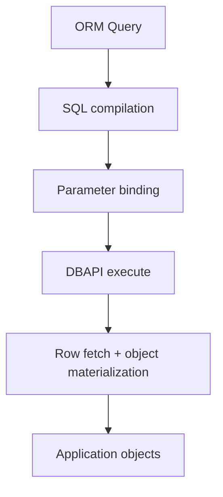
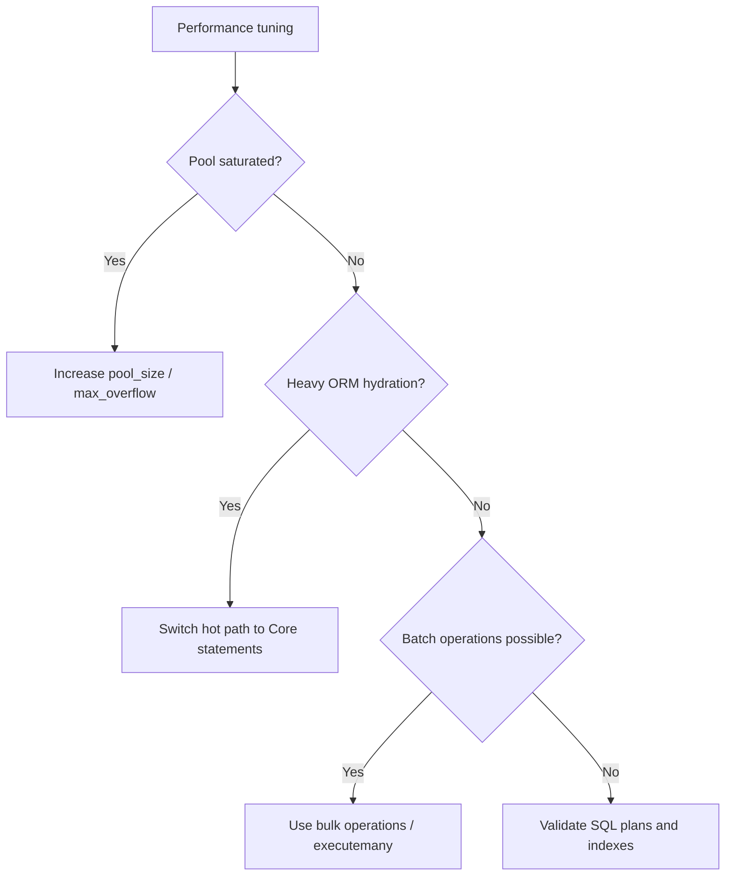

# Performance Guide

This guide covers observed performance for `sqlalchemy-cubrid` and practical optimization patterns.

---

## Table of Contents

- [Overview](#overview)
- [Current Baseline (2026-10-12)](#current-baseline-2026-10-12)
- [Benchmark Results](#benchmark-results)
- [Performance Characteristics](#performance-characteristics)
- [Optimization Tips](#optimization-tips)
- [Running Benchmarks](#running-benchmarks)

---

## Overview

`sqlalchemy-cubrid` adds SQLAlchemy Core/ORM behavior on top of the CUBRID Python driver.

---

## Current Baseline (2026-10-12)

A same-host, same-CUBRID baseline of the current dialect (#830): raw pycubrid,
SQLAlchemy Core and the ORM run identical workloads against one CUBRID server.
It is a reference for later comparisons, not a performance target, and it does
not compare CUBRID with another database.

**Conditions.** sqlalchemy-cubrid `main` at `a570ea4` (the `sqlalchemy_cubrid/`
source equals v1.11.0 apart from one `typing` import in `dml.py`, #827; v1.10.0
and v1.11.0 have identical dialect source), pycubrid 1.12.0 through
`cubrid+pycubrid://`, SQLAlchemy 2.1.4 and 2.0.54, CPython 3.12.13, CUBRID
11.4.6.1963 (`cubrid/cubrid:11.4` image `sha256:1248b77ad398` in Docker, port bound
to 127.0.0.1), Intel
Core i5-9400F (6 cores), Linux 5.15. The host was shared with other CUBRID
containers. Autocommit off, default `QueuePool`, one connection per variant,
no `pool_pre_ping`. Each figure is the median of 5 trials, with the
interquartile range (IQR) of the trial values; every trial first runs one
unrecorded warm-up pass.

**Raw artifacts and commands**:
[`benchmarks/2026-10-12-dialect-baseline/`](https://github.com/cubrid-lab/sqlalchemy-cubrid/tree/main/benchmarks/2026-10-12-dialect-baseline)
(`run.sh`, the worker `input.json`, `raw/`, `summary.json` and `aggregate.py`).
The tools are `scripts/bench_dialect_baseline.py` (statement cache, fetch,
batch DML and reflection; every result is checked), `scripts/bench_compile.py`,
`scripts/profile_orm.py` and the cubrid-benchmark `orm-overhead` workers at
`f5510d0` (single-row CRUD, 10 s per operation after 2 s warm-up, 1,000 seeded
rows, batches of 100, zero errors in every trial).

### Single-row operations and fetch

Per-operation latency in ms (median of the trial p50 values, IQR in brackets),
SQLAlchemy 2.1.4; SQLAlchemy 2.0.54 is in the last two columns.

| Operation (orm-overhead workers) | raw pycubrid | Core | ORM | Core 2.0 | ORM 2.0 |
|---|---:|---:|---:|---:|---:|
| select_by_pk | 0.62 [0.61–0.63] | 0.75 [0.73–0.77] | 1.05 [1.01–1.09] | 0.78 | 1.11 |
| select_full_scan (1,000 rows) | 3.86 [3.82–3.93] | 4.22 [4.20–4.27] | 7.61 [7.59–7.69] | 4.26 | 8.02 |
| insert_single (with commit) | 59.2 [58.5–84.0] | 58.7 [58.5–61.8] | 73.5 [66.9–74.9] | 58.5 | 75.0 |
| update_by_pk (with commit) | 50.5 [50.1–58.4] | 58.0 [58.0–58.0] | 66.6 [66.5–66.7] | 58.3 | 66.6 |
| delete_by_pk (with commit) | 66.7 [50.2–67.4] | 58.5 [58.4–58.6] | 74.9 [67.2–75.0] | 58.5 | 74.8 |

- Reads isolate the client layers: Core adds about 0.13 ms (21%) to a primary-key
  SELECT and 9% to a 1,000-row fetch; the ORM roughly doubles the fetch
  (object materialization).
- Every committed write takes 50–75 ms in steps of about 8.3 ms whatever the
  layer, so the server commit dominates and Core equals raw pycubrid within
  that step. Write medians are a few hundred operations per trial and move by a
  whole step between trials.
- The workers' `insert_batch` steps are not like for like (raw uses
  `executemany()`, Core one insertmanyvalues INSERT, the ORM a unit-of-work
  flush that also deletes object by object), so they are only in the raw files.

### Statement cache, fetch and batch DML

`scripts/bench_dialect_baseline.py`, SQLAlchemy 2.1.4 (2.0.54 in the last
column). One-row SELECT by primary key, 1,000 calls per variant, in µs:

| Variant | 2.1.4 median [IQR] | 2.0.54 median |
|---|---:|---:|
| raw pycubrid | 661 [646–664] | 637 |
| Core, statement cache (default) | 775 [748–847] | 838 |
| Core, `compiled_cache=None` | 996 [984–1012] | 1035 |
| ORM `select(Item)` | 999 [938–1098] | 951 |

Turning the statement cache off costs about 220 µs per execution here
(compilation plus result-metadata setup); offline, `scripts/bench_compile.py`
(10,000 compilations, 5 trials) compiles a SELECT with LIMIT/OFFSET in 91.2 µs
(2.0.54: 84.7), a simple INSERT in 65.4 µs (60.7), an INSERT … ON DUPLICATE KEY
UPDATE in 124.5 µs (117.7) and a SELECT … FOR UPDATE in 70.8 µs (67.0).

Batches of 1,000 rows, each statement timed with its commit and the table
checked afterwards (row count and sum), in ms:

| Variant | INSERT | UPDATE | DELETE |
|---|---:|---:|---:|
| raw `executemany()` | 480 [459–666] | 471 [441–497] | 619 [446–653] |
| raw `executemany(prepared=True)` | 180 [174–195] | 221 [209–247] | 244 [238–288] |
| Core (`insert()` list: insertmanyvalues; `update()`/`delete()` list: `executemany()`) | 99 [95–121] | 577 [421–590] | 567 [456–615] |
| Core, experimental `prepared=True` in `do_executemany` | 116 [112–117] | 239 [223–245] | 280 [216–289] |
| ORM (bulk INSERT, bulk UPDATE by primary key, unit-of-work DELETE) | 108 [105–129] | 466 [447–701] | 498 [440–533] |

- A Core or ORM bulk INSERT is 4.4–4.8 times faster than the driver's own
  `executemany()`: insertmanyvalues sends a few multi-row INSERT statements
  instead of 1,000 single-row statements in one literal batch.
- Core UPDATE/DELETE batches go through `PyCubridDialect.do_executemany()`,
  which calls `cursor.executemany()` unchanged, so they cost the same as the raw
  literal batch (the 2.0.54 medians, 974 and 948 ms, had an IQR of 421–1190 and
  484–1065 ms on the shared host).
- The experimental `prepared=True` override affects only `do_executemany()`, so
  it changes the Core UPDATE and DELETE columns; its INSERT still goes through
  insertmanyvalues (`do_execute()`), and the 116 versus 99 ms INSERT difference
  is run-to-run variation, not an effect of the prepared path.
- Reflecting the table (columns, primary key, foreign keys, indexes and unique
  constraints with a fresh `Inspector`) takes 16.5 ms and 8 SQL statements;
  `MetaData.reflect()` of the table 20.9 ms and 10 statements.

### Where the time goes

`scripts/profile_orm.py` (default workload: 20 single-row ORM CRUD loops and
3 bulk inserts of 300 rows under cProfile) attributes 0.003% of the profiled
request time to the dialect's own modules, 5.9% (2.0.54: 6.7%) to SQLAlchemy
self time (Core and ORM together) and 5.9% to pycubrid self time; the remaining self time is outside
those packages (standard library, socket and builtin calls, which include the
wait for the server's replies).
The script's separate compile-only pass (250 loops of five statements) ranks
the dialect functions by cumulative time as `visit_insert`, `visit_update`,
`visit_delete`, `visit_on_duplicate_key_update` and `limit_clause`. No dialect-specific hotspot or regression was found, so no
dialect change is proposed from this baseline.

### Prepared batch feasibility

pycubrid 1.12.0's opt-in `executemany(..., prepared=True)` (its large-batch
safety work, cubrid-lab/pycubrid#854, is complete) took 0.37–0.47 times the
literal batch's time above, and about 0.4–0.5 times for Core UPDATE/DELETE
through the benchmark-only `do_executemany` override. The dialect keeps the
default path. Its contracts would allow an opt-in, but not a silent default:

- SQLAlchemy sends `executemany()` for UPDATE and DELETE parameter lists and for
  the INSERT fallback of #421; these start with `UPDATE`, `DELETE` or `INSERT`,
  which the prepared path accepts. A statement starting with `WITH` is rejected
  with `NotSupportedError` and there is no fallback.
- On success `rowcount` is the sum of the per-row counts, as the dialect's
  `supports_sane_multi_rowcount` needs; partial-failure, commit and rollback
  behavior and the exception mapping match the literal batch.
- Accepted values are narrower: empty `bytes`, NaN/infinity, collection
  elements other than `str`/`int`/`None` and (with autocommit on) `Lob` values
  are rejected before sending, and conversion errors read "Cannot coerce host
  var" instead of the literal text. Every placeholder must be typable by the
  server.

### Follow-up: CUBRID versions, drivers, async and concurrency (2026-10-13)

The same `scripts/bench_dialect_baseline.py`, extended with a CUBRIDdb route, an
async mode and a concurrent-connections workload, was run on CUBRID 10.2.18.9024,
11.0.16.0419, 11.2.9.0866 and 11.4.6.1963 (official `cubrid/cubrid` images in
Docker, one benchmark server at a time, port bound to 127.0.0.1) through
`cubrid+pycubrid://`, `cubrid://` (CUBRIDdb built from cubrid-python v11.3.0.51,
reported as `11.3.0.1`) and `cubrid+aiopycubrid://`. Same host, CPython 3.12.13,
pycubrid 1.12.0 and SQLAlchemy 2.1.4 as above. From the 11.0 async run onward, one
to five CUBRID containers of unrelated work also ran on the host (mostly idle,
3–5% CPU each when sampled). Each figure is the median of 5 trials; the IQRs,
every trial value and the exact commands are in
[`benchmarks/2026-10-13-dialect-baseline-followup/`](https://github.com/cubrid-lab/sqlalchemy-cubrid/tree/main/benchmarks/2026-10-13-dialect-baseline-followup).
The CUBRID 11.4 pycubrid reads match the 2026-10-12 run within the trial
spread; batch timings vary widely in both runs.

One connection, one-row SELECT by primary key in µs and SELECT of 1,000 rows in ms:

| Server | Driver | raw | Core | Core, no cache | ORM | Core fetch | ORM fetch |
|---|---|---:|---:|---:|---:|---:|---:|
| 10.2 | pycubrid | 506 | 627 | 892 | 760 | 4.57 | 7.83 |
| 10.2 | CUBRIDdb | 455 | 646 | 842 | 748 | 4.24 | 7.46 |
| 10.2 | aiopycubrid | 553 | 767 | 946 | 986 | 4.51 | 8.15 |
| 11.0 | pycubrid | 435 | 579 | 767 | 649 | 3.98 | 7.29 |
| 11.0 | CUBRIDdb | 447 | 582 | 789 | 736 | 4.09 | 7.33 |
| 11.0 | aiopycubrid | 635 | 859 | 1123 | 988 | 4.65 | 8.31 |
| 11.2 | pycubrid | 730 | 762 | 1019 | 905 | 4.35 | 7.99 |
| 11.2 | CUBRIDdb | 509 | 651 | 863 | 753 | 4.06 | 7.52 |
| 11.2 | aiopycubrid | 1295 | 1367 | 1456 | 1508 | 4.84 | 8.30 |
| 11.4 | pycubrid | 595 | 764 | 973 | 956 | 4.90 | 8.11 |
| 11.4 | CUBRIDdb | 551 | 691 | 899 | 765 | 3.79 | 7.25 |
| 11.4 | aiopycubrid | 653 | 876 | 1158 | 1062 | 4.49 | 8.03 |

- No server version is consistently faster or slower; the differences between
  rows are within the trial-to-trial spread.
- The two sync drivers are close: a raw one-row SELECT takes 447–551 µs through
  CUBRIDdb and 435–730 µs through pycubrid, and Core and ORM differ by less than
  0.2 ms.
- The async route adds 0.1–0.6 ms to a Core one-row SELECT on one connection
  (event loop and greenlet bridge) and at most 0.7 ms to a Core 1,000-row fetch.
- Reflection (sync drivers only) takes 13.3–16.2 ms with a fresh `Inspector` and
  16.4–21.1 ms with `MetaData.reflect()`, with the same 8 and 10 SQL statements on
  every server and both drivers.

Batch UPDATE of 1,000 rows with its commit, in ms (INSERT through
insertmanyvalues is in the last column):

| Server | raw `executemany()` | raw `prepared=True` | Core, pycubrid | Core, CUBRIDdb | Core, async | Core INSERT, any driver |
|---|---:|---:|---:|---:|---:|---:|
| 10.2 | 798 | 257 | 1032 | 1047 | 351 | 126–190 |
| 11.0 | 413 | 259 | 633 | 556 | 391 | 116–264 |
| 11.2 | 703 | 231 | 778 | 497 | 805 | 82–125 |
| 11.4 | 637 | 220 | 409 | 805 | 398 | 81–124 |

- Literal batches (raw `executemany()` and Core UPDATE/DELETE lists) took
  231–1,296 ms with wide IQRs and no consistent order by server or driver. The
  prepared INSERT and UPDATE (164–261 ms) and the insertmanyvalues INSERT (72–264
  ms, mostly 81–131 ms) stay the cheaper paths on every server and driver.
- On CUBRIDdb, Core UPDATE/DELETE lists run one `execute()` per row (the
  dialect's `do_executemany()` guard for CUBRIDdb's unbound `None` and last-row
  `rowcount`), not the driver's own `executemany()`.

Concurrent connections on CUBRID 11.4: N workers start together, each on its own
connection (threads for the sync drivers, `asyncio` tasks for async); 500 one-row
SELECTs or 50 committed single-row UPDATEs per worker, in operations per second
from the first counted operation's start to the last one's end:

| Driver | Connections | raw SELECT | Core SELECT | ORM SELECT | Core UPDATE + commit |
|---|---:|---:|---:|---:|---:|
| pycubrid (threads) | 4 | 4781 | 3672 | 3017 | 64 |
| pycubrid (threads) | 8 | 5450 | 3814 | 3047 | 107 |
| CUBRIDdb (threads) | 4 | 1623 | 390 | 433 | 28 |
| CUBRIDdb (threads) | 8 | 839 | 479 | 581 | 25 |
| aiopycubrid (tasks) | 4 | 4222 | 3030 | 2536 | 52 |
| aiopycubrid (tasks) | 8 | 4814 | 3238 | 2598 | 89 |

- pycubrid threads scale on every server: 4,781–5,771 raw and 3,672–3,966 Core
  SELECTs/s with 4 connections, 5,450–5,982 and 3,587–3,916 with 8. Core and ORM
  level off at about 3,600–3,900 and 2,700–3,100 SELECTs/s, which suggests the
  client process (one Python interpreter) is the limit there.
- The async route scales the same way, slightly lower: 4,222–5,184 raw and
  3,030–3,378 Core SELECTs/s with 4 tasks, 4,814–5,955 and 3,238–3,405 with 8.
- Committed UPDATEs, about 22/s on one connection, mostly rise to 30–64/s with 4
  connections and 89–110/s with 8 through pycubrid and the async route, with a
  p50 of 66–83 ms, so the server overlaps the commits. Two runs did not (11.0
  pycubrid threads: 6, 15 and 30/s with 1, 4 and 8 connections, p50 155–218 ms;
  10.2 async: 15 and 34/s with 4 and 8, p50 202–224 ms); the cause was not
  investigated.
- CUBRIDdb does not scale: with 4 or 8 threads it never exceeded one
  connection's throughput (278–1,782 SELECTs/s; one connection alone does about
  1,800–2,200 raw SELECTs/s, first table) and stayed at 20–28 committed UPDATEs/s
  on every server. Its C extension (`cubrid_ext/python_cubrid.c` at v11.3.0.51)
  contains no `Py_BEGIN_ALLOW_THREADS`, so it holds the GIL during server round
  trips and the threads wait for each other. Multi-threaded applications should
  use pycubrid.
- The one-connection row of this workload varied widely between servers and
  trials (433–2,046 raw SELECTs/s), so the single-connection comparison uses the
  first table.

Not measured: `pool_pre_ping`, Python other than 3.12, SQLAlchemy 2.0 on the
follow-up's servers and drivers, more than 8 connections or several client
processes, the async route's reflection (it runs the same synchronous dialect
code through `run_sync`), remote networks and server-side resource use.

---

## Benchmark Results

The results in this section are historical. They were measured on earlier
releases and other hosts and do not describe v1.11.0; see
[Current Baseline (2026-10-12)](#current-baseline-2026-10-12) for current numbers.

Source: [cubrid-benchmark](https://github.com/cubrid-lab/cubrid-benchmark)

Environment: Intel Core i5-9400F @ 2.90GHz, 6 cores, Linux x86_64, Docker containers.

Baseline driver workload (2026-03-16, cubrid-benchmark `baseline-multilang`): Python `pycubrid` vs `PyMySQL`, 10000 rows x 5 rounds.

| Scenario | CUBRID (pycubrid baseline) | MySQL (PyMySQL) | Ratio (CUBRID/MySQL) |
|---|---:|---:|---:|
| insert_sequential | 10.47s | 1.74s | 6.0x |
| select_by_pk | 15.99s | 3.52s | 4.5x |
| select_full_scan | 10.31s | 1.86s | 5.5x |
| update_indexed | 10.70s | 2.19s | 4.9x |
| delete_sequential | 10.75s | 2.10s | 5.1x |

Note: SQLAlchemy adds extra overhead for SQL compilation, ORM identity mapping, and object creation.

### Issue #104 — ORM dialect profile and optimization

Measured in April 2026 on the local benchmark environment used for Issue #104:

| Scenario | Before | After | Delta |
|---|---:|---:|---:|
| Tier 2 single-row CRUD (mean) | 155.99 ms | 268.41 ms | 72.1% slower* |
| Tier 2 bulk insert (100 rows, mean) | 370.33 ms | 356.09 ms | **3.9% faster** |
| Tier 2 bulk insert (1000 rows, mean) | 2864.56 ms | 2511.52 ms | **12.3% faster** |
| Tier 2 query builder select-all (mean) | 39.76 ms | 31.83 ms | **19.9% faster** |

Profiling with `scripts/profile_orm.py` showed that dialect-layer self time is a very small fraction of total
request time on CRUD-heavy ORM paths, with most elapsed time still spent in SQLAlchemy ORM/Core coordination
and the `pycubrid` driver. In the profiled workload captured for Issue #104:

- dialect-layer self time was **0.0009% of total request time**
- SQLAlchemy Core self time was **6.55% of total request time**
- `pycubrid` self time was **7.01% of total request time**
- ORM select overhead vs raw SQL select was **18.08% of ORM select time**

Top dialect-layer hotspots from the compilation-focused profiler pass were:

1. `compiler.py:visit_on_duplicate_key_update`
2. `compiler.py:limit_clause`
3. `compiler.py:update_limit_clause`
4. `compiler.py:<dictcomp>` inside `visit_on_duplicate_key_update`
5. `compiler.py:replace` inside `visit_on_duplicate_key_update`

Shipped optimization:

- Enabled SQLAlchemy 2.x `insertmanyvalues` for the CUBRID dialect (`use_insertmanyvalues=True` and
  `use_insertmanyvalues_wo_returning=True`) so ORM bulk inserts can batch into multi-values INSERT forms
  without changing the public API.

\* The single-row CRUD benchmark showed high variance in this local run, so the clear repeatable improvement from
this change set is the bulk insert path rather than singleton unit-of-work latency.

---

## Performance Characteristics

- The dialect inherits `pycubrid` transport behavior and CAS protocol costs.
- Core query compilation is fast but non-zero; repeated dynamic SQL can accumulate overhead.
- ORM paths add identity map and model materialization costs compared to raw DBAPI usage.
- Pool configuration strongly impacts latency under concurrency.
- Bulk APIs and Core statements generally outperform row-by-row ORM unit-of-work patterns.

---

## Optimization Tips

- Configure pooling explicitly (example: `pool_size`, `max_overflow`, `pool_pre_ping=True`).
- Use SQLAlchemy Core for high-volume bulk writes and large read pipelines.
- Use `executemany`-friendly patterns for insert/update bursts.
- Keep transactions explicit and avoid autocommit-style tiny transactions.
- Limit ORM object hydration when only scalar/tuple output is needed.

---

## Running Benchmarks

1. Clone: `git clone https://github.com/cubrid-lab/cubrid-benchmark`.
2. Start the benchmark database containers per the benchmark documentation.
3. Run the Python benchmark suite to establish DBAPI baseline metrics.
4. Run SQLAlchemy-specific scenarios on the same host and dataset shape.
5. Compare driver baseline vs ORM/Core runs to isolate framework overhead.

Use the benchmark repository documentation for the exact command set and runner scripts.

The current baseline is reproduced with
`benchmarks/2026-10-12-dialect-baseline/run.sh`, which runs
`scripts/bench_dialect_baseline.py`, `scripts/bench_compile.py`,
`scripts/profile_orm.py` and the cubrid-benchmark `orm-overhead` workers against
one CUBRID container; `python aggregate.py` in that directory rebuilds
`summary.json` from `raw/`. The 2026-10-13 follow-up is reproduced with
`benchmarks/2026-10-13-dialect-baseline-followup/run.sh`, which starts each CUBRID
version in turn and runs `scripts/bench_dialect_baseline.py` through the three
drivers with `--concurrency 1,4,8`.
