# Architecture guide

> Moved from the root [AGENTS.md](../../AGENTS.md) (#907). Owner: sqlalchemy-cubrid maintainers.
> Every rule in the root file still applies. Scope: Package map, module responsibilities and entry points. [docs/ARCHITECTURE.md](../ARCHITECTURE.md) explains the design.

## Architecture

```mermaid
graph TD
    root["sqlalchemy_cubrid/ (Main package + py.typed)"]
    init["__init__.py - Public API exports types, insert(), merge(), replace(), trace_query(), __version__"]
    compat["_compat.py - SQLAlchemy private API compatibility helpers"]
    base["base.py - CubridExecutionContext, CubridIdentifierPreparer"]
    compiler["compiler.py - CubridSQLCompiler, CubridDDLCompiler, CubridTypeCompiler"]
    dialect["dialect.py - CubridDialect reflection, connection, isolation levels"]
    pycubrid["pycubrid_dialect.py - PyCubridDialect pure Python driver variant"]
    aio["aio_pycubrid_dialect.py - PyCubridAsyncDialect async driver variant"]
    dml["dml.py - ON DUPLICATE KEY UPDATE (Insert), MERGE statement"]
    trace["trace.py - Query tracing helper"]
    types["types.py - CUBRID type system numeric, string, LOB, collection"]
    req["requirements.py - SA 2.0 test requirement flags"]
    alembic["alembic_impl.py - CubridImpl for Alembic migrations"]
    typed["py.typed - PEP 561 marker"]

    root --> init
    root --> compat
    root --> base
    root --> compiler
    root --> dialect
    root --> pycubrid
    root --> aio
    root --> dml
    root --> trace
    root --> types
    root --> req
    root --> alembic
    root --> typed
```



### Module Responsibilities

| Module | Role |
|---|---|
| `dialect.py` | Main dialect class. Handles `create_connect_args`, reflection (`get_columns`, `get_pk_constraint`, `get_foreign_keys`, `get_indexes`, `get_table_comment`, etc.), isolation levels, `import_dbapi()`. |
| `pycubrid_dialect.py` | `PyCubridDialect` — subclasses `CubridDialect` for the pycubrid pure Python driver. Overrides `import_dbapi()`, `create_connect_args()`, `on_connect()`, `do_ping()`, `do_executemany()`, isolation re-apply, and the pycubrid part of disconnect detection (`errno`, client-side messages). |
| `aio_pycubrid_dialect.py` | `PyCubridAsyncDialect` — async pycubrid variant for `create_async_engine()` / `AsyncSession`, registered as `cubrid.aiopycubrid`. Inherits all driver policy from `PyCubridDialect`; adds only the async adapter, pool class and `get_driver_connection()`. |
| `compiler.py` | SQL compilation. `visit_cast`, `limit_clause`, `for_update_clause`, `update_limit_clause`, DDL (`get_column_specification`, `AUTO_INCREMENT`, `COMMENT`), type compilation for all CUBRID types. |
| `dml.py` | Custom DML constructs: `insert()` with `.on_duplicate_key_update()`, `merge()` with `.using()`, `.on()`, `.when_matched_then_update()`, `.when_not_matched_then_insert()`. |
| `types.py` | Type classes: `STRING`, `BIT`, `CLOB`, `SET`, `MULTISET`, `SEQUENCE`, `MONETARY`, `OBJECT`, plus standard type overrides. |
| `base.py` | Execution context (`get_lastrowid`), identifier preparer (lowercase folding, 254-char max, reserved words). |
| `trace.py` | `trace_query()` helper that enables CUBRID tracing around a statement and returns trace output. |
| `requirements.py` | Test requirement flags — marks what CUBRID does/doesn't support for SA's test suite. |
| `alembic_impl.py` | `CubridImpl(DefaultImpl)` with `transactional_ddl = True` (CUBRID DDL rolls back with the transaction); `emit_begin()` emits nothing because CUBRID has no `BEGIN`. Registered by the `alembic.plugins` entry point (`_sqlalchemy_cubrid_alembic.py`) on Alembic 1.18+, or by `dialect.py` importing it on Alembic 1.7.2-1.17 (#595). |
| `_compat.py` | Internal compatibility helpers that wrap SQLAlchemy private APIs used by the dialect/compiler. |

### Entry Points (pyproject.toml)

```toml
[project.entry-points."sqlalchemy.dialects"]
cubrid = "sqlalchemy_cubrid.dialect:CubridDialect"
"cubrid.cubrid" = "sqlalchemy_cubrid.dialect:CubridDialect"
"cubrid.cubriddb" = "sqlalchemy_cubrid.dialect:CubridDialect"
"cubrid.pycubrid" = "sqlalchemy_cubrid.pycubrid_dialect:PyCubridDialect"
"cubrid.aiopycubrid" = "sqlalchemy_cubrid.aio_pycubrid_dialect:PyCubridAsyncDialect"

[project.entry-points."alembic.plugins"]
sqlalchemy_cubrid = "_sqlalchemy_cubrid_alembic"
```
