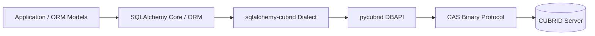
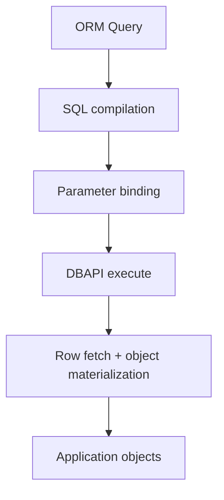
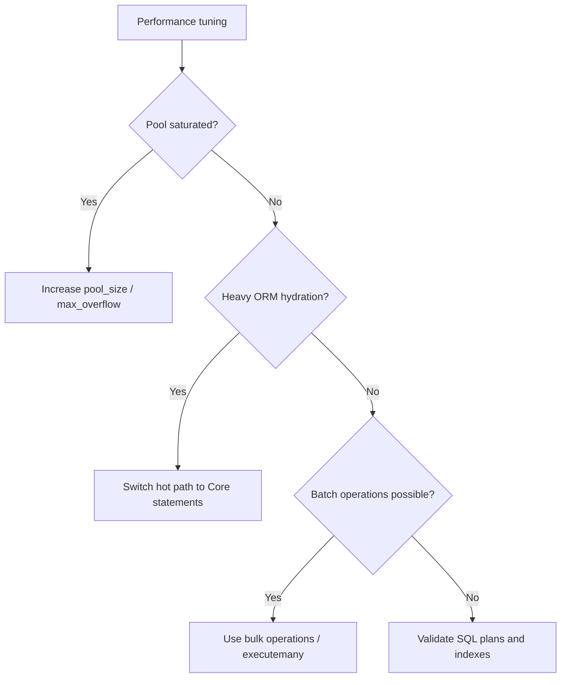

# 성능 가이드 (한국어)

> 🌐 [PERFORMANCE.md](https://github.com/cubrid-lab/sqlalchemy-cubrid/blob/main/docs/PERFORMANCE.md)의 번역입니다. 영어 원문이 표준이며, CI가 영어 원문과의 구조 일치를 검사합니다.

이 가이드는 `sqlalchemy-cubrid`의 관측된 성능과 실용적인 최적화 패턴을 다룹니다.

---

## 목차

- [개요](#개요)
- [현재 기준선 (2026-10-12)](#현재-기준선-2026-10-12)
- [벤치마크 아티팩트 계약](#벤치마크-아티팩트-계약)
- [벤치마크 결과](#벤치마크-결과)
- [성능 특성](#성능-특성)
- [최적화 팁](#최적화-팁)
- [벤치마크 실행](#벤치마크-실행)

---

## 개요

`sqlalchemy-cubrid`는 CUBRID Python 드라이버 위에 SQLAlchemy Core/ORM 동작을 얹습니다.





---

## 현재 기준선 (2026-10-12)

현재 방언의 같은 호스트, 같은 CUBRID 기준선입니다(#830). raw pycubrid,
SQLAlchemy Core, ORM이 하나의 CUBRID 서버에 같은 워크로드를 실행합니다.
이후 비교를 위한 기준이며 성능 목표가 아니고, CUBRID를 다른 데이터베이스와
비교하지 않습니다.

**조건.** sqlalchemy-cubrid `main` `a570ea4`(`sqlalchemy_cubrid/` 소스는
`dml.py`의 `typing` import 하나(#827)를 빼면 v1.11.0과 같으며, v1.10.0과
v1.11.0의 방언 소스는 동일), `cubrid+pycubrid://`를 통한 pycubrid 1.12.0,
SQLAlchemy 2.1.4와 2.0.54, CPython 3.12.13, CUBRID 11.4.6.1963(Docker의
`cubrid/cubrid:11.4` 이미지 `sha256:1248b77ad398`, 포트는 127.0.0.1에
바인딩), Intel Core i5-9400F(6코어),
Linux 5.15. 호스트는 다른 CUBRID 컨테이너와 공유되었습니다. 오토커밋 꺼짐,
기본 `QueuePool`, 변형마다 연결 하나, `pool_pre_ping` 없음. 각 수치는 5회
시행의 중앙값이며 시행 값의 사분위 범위(IQR)를 함께 적었습니다. 모든 시행은
기록하지 않는 워밍업을 먼저 한 번 실행합니다.

**원시 산출물과 명령**:
[`benchmarks/2026-10-12-dialect-baseline/`](https://github.com/cubrid-lab/sqlalchemy-cubrid/tree/main/benchmarks/2026-10-12-dialect-baseline)
(`run.sh`, 워커 `input.json`, `raw/`, `summary.json`, `aggregate.py`).
도구는 `scripts/bench_dialect_baseline.py`(문 캐시, 조회, 배치 DML, 리플렉션.
모든 결과를 검증), `scripts/bench_compile.py`, `scripts/profile_orm.py`,
cubrid-benchmark `f5510d0`의 `orm-overhead` 워커(단일 행 CRUD, 2초 워밍업 후
연산마다 10초, 시드 1,000행, 배치 100행, 모든 시행에서 오류 0)입니다.

### 단일 행 연산과 조회

연산당 지연 시간(ms, 시행 p50 값의 중앙값, 괄호 안은 IQR), SQLAlchemy 2.1.4.
SQLAlchemy 2.0.54는 마지막 두 열입니다.

| 연산 (orm-overhead 워커) | raw pycubrid | Core | ORM | Core 2.0 | ORM 2.0 |
|---|---:|---:|---:|---:|---:|
| select_by_pk | 0.62 [0.61–0.63] | 0.75 [0.73–0.77] | 1.05 [1.01–1.09] | 0.78 | 1.11 |
| select_full_scan (1,000행) | 3.86 [3.82–3.93] | 4.22 [4.20–4.27] | 7.61 [7.59–7.69] | 4.26 | 8.02 |
| insert_single (커밋 포함) | 59.2 [58.5–84.0] | 58.7 [58.5–61.8] | 73.5 [66.9–74.9] | 58.5 | 75.0 |
| update_by_pk (커밋 포함) | 50.5 [50.1–58.4] | 58.0 [58.0–58.0] | 66.6 [66.5–66.7] | 58.3 | 66.6 |
| delete_by_pk (커밋 포함) | 66.7 [50.2–67.4] | 58.5 [58.4–58.6] | 74.9 [67.2–75.0] | 58.5 | 74.8 |

- 읽기는 클라이언트 계층을 분리해 보여 줍니다. Core는 기본 키 SELECT에 약
  0.13 ms(21%), 1,000행 조회에 9%를 더하고, ORM은 조회 시간을 약 두 배로
  늘립니다(객체 구체화).
- 커밋하는 쓰기는 계층과 무관하게 약 8.3 ms 단위로 50–75 ms가 걸리므로 서버
  커밋이 지배적이고, Core는 그 단위 안에서 raw pycubrid와 같습니다. 쓰기는
  시행당 수백 회에 불과해 중앙값이 시행 사이에 한 단위씩 움직입니다.
- 워커의 `insert_batch` 단계는 같은 작업이 아니므로(raw는 `executemany()`,
  Core는 insertmanyvalues INSERT 하나, ORM은 객체별 삭제까지 하는 unit-of-work
  flush) 원시 파일에만 있습니다.

### 문 캐시, 조회, 배치 DML

`scripts/bench_dialect_baseline.py`, SQLAlchemy 2.1.4(마지막 열은 2.0.54).
기본 키로 한 행을 SELECT, 변형마다 1,000회 호출, 단위 µs:

| 변형 | 2.1.4 중앙값 [IQR] | 2.0.54 중앙값 |
|---|---:|---:|
| raw pycubrid | 661 [646–664] | 637 |
| Core, 문 캐시 사용(기본) | 775 [748–847] | 838 |
| Core, `compiled_cache=None` | 996 [984–1012] | 1035 |
| ORM `select(Item)` | 999 [938–1098] | 951 |

문 캐시를 끄면 여기서 실행마다 약 220 µs(컴파일과 결과 메타데이터 준비)가
더 듭니다. 오프라인에서 `scripts/bench_compile.py`(컴파일 10,000회, 5회 시행)는
LIMIT/OFFSET이 있는 SELECT를 91.2 µs(2.0.54: 84.7), 단순 INSERT를 65.4 µs(60.7),
INSERT … ON DUPLICATE KEY UPDATE를 124.5 µs(117.7), SELECT … FOR UPDATE를
70.8 µs(67.0)에 컴파일합니다.

1,000행 배치, 각 문은 커밋까지 시간을 재고 이후 테이블(행 수와 합계)을 검증,
단위 ms:

| 변형 | INSERT | UPDATE | DELETE |
|---|---:|---:|---:|
| raw `executemany()` | 480 [459–666] | 471 [441–497] | 619 [446–653] |
| raw `executemany(prepared=True)` | 180 [174–195] | 221 [209–247] | 244 [238–288] |
| Core (`insert()` 목록: insertmanyvalues, `update()`/`delete()` 목록: `executemany()`) | 99 [95–121] | 577 [421–590] | 567 [456–615] |
| Core, `do_executemany`의 실험적 `prepared=True` | 116 [112–117] | 239 [223–245] | 280 [216–289] |
| ORM (대량 INSERT, 기본 키 기준 대량 UPDATE, unit-of-work DELETE) | 108 [105–129] | 466 [447–701] | 498 [440–533] |

- Core나 ORM 대량 INSERT는 드라이버 자체 `executemany()`보다 4.4–4.8배
  빠릅니다. insertmanyvalues는 1,000개의 단일 행 문을 한 리터럴 배치로 보내는
  대신 여러 행 INSERT 문 몇 개를 보냅니다.
- Core UPDATE/DELETE 배치는 `cursor.executemany()`를 그대로 호출하는
  `PyCubridDialect.do_executemany()`를 거치므로 raw 리터럴 배치와 비용이 같습니다
  (2.0.54 중앙값 974 ms와 948 ms는 공유 호스트에서 IQR이 421–1190 ms와
  484–1065 ms였습니다).
- 실험적 `prepared=True` 재정의는 `do_executemany()`에만 영향을 주므로 Core
  UPDATE와 DELETE 열을 바꿉니다. INSERT는 여전히 insertmanyvalues
  (`do_execute()`)를 거치며, INSERT의 116 ms 대 99 ms 차이는 prepared 경로의
  효과가 아니라 실행 간 변동입니다.
- 테이블 리플렉션(새 `Inspector`로 컬럼, 기본 키, 외래 키, 인덱스, 유니크 제약)은
  16.5 ms와 SQL 문 8개, 테이블의 `MetaData.reflect()`는 20.9 ms와 문 10개가
  걸립니다.

### 시간이 쓰이는 곳

`scripts/profile_orm.py`(기본 워크로드: cProfile 아래 단일 행 ORM CRUD 20회와
300행 대량 삽입 3회)는 프로파일된 요청 시간의 0.003%를 방언 자체 모듈에,
5.9%(2.0.54: 6.7%)를 SQLAlchemy 자기 시간(Core와 ORM 합계)에, 5.9%를 pycubrid
자기 시간에 귀속합니다. 나머지 자기 시간은 이 패키지들 밖(표준 라이브러리, 소켓,
내장 함수 호출이며 서버 응답 대기를 포함)에 있습니다. 스크립트의 별도 컴파일 전용 패스(문
다섯 개를 250회 반복)는 누적 시간 기준 방언 함수를 `visit_insert`,
`visit_update`, `visit_delete`, `visit_on_duplicate_key_update`, `limit_clause`
순으로 꼽습니다. 방언 고유의 핫스팟이나
회귀는 발견되지 않았으므로 이 기준선에서 방언 변경을 제안하지 않습니다.

### Prepared 배치 타당성

pycubrid 1.12.0의 옵트인 `executemany(..., prepared=True)`(대량 배치 안전성
작업 cubrid-lab/pycubrid#854 완료)는 위에서 리터럴 배치 시간의 0.37–0.47배,
벤치마크 전용 `do_executemany` 재정의를 거친 Core UPDATE/DELETE에서는 약
0.4–0.5배가 걸렸습니다. 방언은 기본 경로를 유지합니다. 계약상 옵트인은
가능하지만 조용한 기본값 변경은 안 됩니다.

- SQLAlchemy는 UPDATE와 DELETE 파라미터 목록, 그리고 #421의 INSERT 대체 경로에
  `executemany()`를 보냅니다. 이 문들은 prepared 경로가 받아들이는 `UPDATE`,
  `DELETE`, `INSERT`로 시작합니다. `WITH`로 시작하는 문은 `NotSupportedError`로
  거부되며 대체 경로가 없습니다.
- 성공 시 `rowcount`는 행별 개수의 합으로, 방언의
  `supports_sane_multi_rowcount`에 필요한 값입니다. 부분 실패, 커밋과 롤백 동작,
  예외 매핑은 리터럴 배치와 같습니다.
- 허용 값이 더 좁습니다. 빈 `bytes`, NaN/무한대, `str`/`int`/`None` 이외의
  컬렉션 요소, (오토커밋 켜짐에서) `Lob` 값은 전송 전에 거부되고, 변환 오류
  문구는 리터럴 문구 대신 "Cannot coerce host var"입니다. 모든 플레이스홀더는
  서버가 타입을 정할 수 있어야 합니다.

### 후속 측정: CUBRID 버전, 드라이버, 비동기, 동시성 (2026-10-13)

CUBRIDdb 경로, 비동기 모드, 동시 연결 워크로드를 추가한 같은
`scripts/bench_dialect_baseline.py`를 CUBRID 10.2.18.9024, 11.0.16.0419,
11.2.9.0866, 11.4.6.1963(Docker의 공식 `cubrid/cubrid` 이미지, 한 번에 벤치마크
서버 하나, 포트는 127.0.0.1에 바인딩)에서 `cubrid+pycubrid://`,
`cubrid://`(cubrid-python v11.3.0.51로 빌드한 CUBRIDdb, `11.3.0.1`로 표시),
`cubrid+aiopycubrid://`로 실행했습니다. 호스트, CPython 3.12.13, pycubrid 1.12.0,
SQLAlchemy 2.1.4는 위와 같습니다. 11.0 비동기 실행부터는 관련 없는 작업의 CUBRID
컨테이너 1–5개도 호스트에서 실행되었습니다(대부분 유휴, 확인 시 각 3–5% CPU).
각 수치는 5회 시행의 중앙값이며, IQR, 모든 시행 값, 정확한 명령은
[`benchmarks/2026-10-13-dialect-baseline-followup/`](https://github.com/cubrid-lab/sqlalchemy-cubrid/tree/main/benchmarks/2026-10-13-dialect-baseline-followup)에
있습니다. CUBRID 11.4 pycubrid의 조회는 2026-10-12 실행과 시행 간 편차 안에서
같고, 배치 시간은 두 실행 모두에서 크게 달라집니다.

연결 하나, 기본 키로 한 행 SELECT(µs)와 1,000행 SELECT(ms):

| 서버 | 드라이버 | raw | Core | Core, 캐시 없음 | ORM | Core 조회 | ORM 조회 |
|---|---|---:|---:|---:|---:|---:|---:|
| 10.2 | pycubrid | 506 | 627 | 892 | 760 | 4.57 | 7.83 |
| 10.2 | CUBRIDdb | 455 | 646 | 842 | 748 | 4.24 | 7.46 |
| 10.2 | aiopycubrid | 553 | 767 | 946 | 986 | 4.51 | 8.15 |
| 11.0 | pycubrid | 435 | 579 | 767 | 649 | 3.98 | 7.29 |
| 11.0 | CUBRIDdb | 447 | 582 | 789 | 736 | 4.09 | 7.33 |
| 11.0 | aiopycubrid | 635 | 859 | 1123 | 988 | 4.65 | 8.31 |
| 11.2 | pycubrid | 730 | 762 | 1019 | 905 | 4.35 | 7.99 |
| 11.2 | CUBRIDdb | 509 | 651 | 863 | 753 | 4.06 | 7.52 |
| 11.2 | aiopycubrid | 1295 | 1367 | 1456 | 1508 | 4.84 | 8.30 |
| 11.4 | pycubrid | 595 | 764 | 973 | 956 | 4.90 | 8.11 |
| 11.4 | CUBRIDdb | 551 | 691 | 899 | 765 | 3.79 | 7.25 |
| 11.4 | aiopycubrid | 653 | 876 | 1158 | 1062 | 4.49 | 8.03 |

- 일관되게 더 빠르거나 느린 서버 버전은 없습니다. 행 사이의 차이는 시행 간 편차
  안에 있습니다.
- 두 동기 드라이버는 비슷합니다. raw 한 행 SELECT는 CUBRIDdb로 447–551 µs,
  pycubrid로 435–730 µs이며, Core와 ORM 차이는 0.2 ms 미만입니다.
- 비동기 경로는 연결 하나에서 Core 한 행 SELECT에 0.1–0.6 ms, Core 1,000행
  조회에 최대 0.7 ms를 더합니다(이벤트 루프와 greenlet 브리지).
- 리플렉션(동기 드라이버만)은 새 `Inspector`로 13.3–16.2 ms,
  `MetaData.reflect()`로 16.4–21.1 ms이며, 모든 서버와 두 드라이버에서 SQL 문이
  같은 8개와 10개입니다.

커밋을 포함한 1,000행 배치 UPDATE(ms, insertmanyvalues를 통한 INSERT는 마지막 열):

| 서버 | raw `executemany()` | raw `prepared=True` | Core, pycubrid | Core, CUBRIDdb | Core, 비동기 | Core INSERT, 모든 드라이버 |
|---|---:|---:|---:|---:|---:|---:|
| 10.2 | 798 | 257 | 1032 | 1047 | 351 | 126–190 |
| 11.0 | 413 | 259 | 633 | 556 | 391 | 116–264 |
| 11.2 | 703 | 231 | 778 | 497 | 805 | 82–125 |
| 11.4 | 637 | 220 | 409 | 805 | 398 | 81–124 |

- 리터럴 배치(raw `executemany()`와 Core UPDATE/DELETE 목록)는 231–1,296 ms였고
  IQR이 넓으며 서버나 드라이버에 따른 일관된 순서가 없습니다. prepared INSERT와
  UPDATE(164–261 ms), insertmanyvalues INSERT(72–264 ms, 대부분 81–131 ms)는 모든
  서버와 드라이버에서 더 저렴한 경로로 남습니다.
- CUBRIDdb에서 Core UPDATE/DELETE 목록은 드라이버 자체 `executemany()`가 아니라
  행마다 `execute()` 하나로 실행됩니다(CUBRIDdb가 `None`을 바인딩하지 않고
  `rowcount`가 마지막 행 값인 문제에 대한 방언의 `do_executemany()` 보호).

CUBRID 11.4의 동시 연결: 작업자 N개가 각자 연결 하나로 동시에 시작합니다(동기
드라이버는 스레드, 비동기는 `asyncio` 태스크). 작업자마다 한 행 SELECT 500개 또는
커밋하는 한 행 UPDATE 50개이며, 단위는 첫 번째로 센 연산의 시작부터 마지막 연산의
끝까지의 초당 연산 수입니다:

| 드라이버 | 연결 수 | raw SELECT | Core SELECT | ORM SELECT | Core UPDATE + 커밋 |
|---|---:|---:|---:|---:|---:|
| pycubrid(스레드) | 4 | 4781 | 3672 | 3017 | 64 |
| pycubrid(스레드) | 8 | 5450 | 3814 | 3047 | 107 |
| CUBRIDdb(스레드) | 4 | 1623 | 390 | 433 | 28 |
| CUBRIDdb(스레드) | 8 | 839 | 479 | 581 | 25 |
| aiopycubrid(태스크) | 4 | 4222 | 3030 | 2536 | 52 |
| aiopycubrid(태스크) | 8 | 4814 | 3238 | 2598 | 89 |

- pycubrid 스레드는 모든 서버에서 확장됩니다. 연결 4개에서 raw 4,781–5,771,
  Core 3,672–3,966 SELECT/s, 8개에서 5,450–5,982와 3,587–3,916입니다. Core와 ORM은
  약 3,600–3,900과 2,700–3,100 SELECT/s에서 멈추며, 이는 클라이언트 프로세스(Python
  인터프리터 하나)가 한계임을 시사합니다.
- 비동기 경로도 같은 방식으로 확장되며 조금 낮습니다. 태스크 4개에서 raw
  4,222–5,184, Core 3,030–3,378 SELECT/s, 8개에서 4,814–5,955와 3,238–3,405입니다.
- 커밋하는 UPDATE는 연결 하나에서 약 22/s이고, pycubrid와 비동기 경로로 대부분 연결
  4개에서 30–64/s, 8개에서 89–110/s로 늘며 p50은 66–83 ms이므로 서버가 커밋을 겹쳐
  처리합니다. 두 실행은 그렇지 않았습니다(11.0 pycubrid 스레드: 연결 1, 4, 8개에서
  6, 15, 30/s, p50 155–218 ms; 10.2 비동기: 4개와 8개에서 15와 34/s, p50
  202–224 ms). 원인은 조사하지 않았습니다.
- CUBRIDdb는 확장되지 않습니다. 스레드 4개나 8개에서 연결 하나의 처리량을 넘은 적이
  없고(278–1,782 SELECT/s, 연결 하나만으로 raw SELECT 약 1,800–2,200/s, 첫 번째 표
  기준) 모든 서버에서 커밋하는 UPDATE 20–28/s에 머물렀습니다. C 확장(v11.3.0.51의
  `cubrid_ext/python_cubrid.c`)에는 `Py_BEGIN_ALLOW_THREADS`가 없어 서버 왕복 동안
  GIL을 잡고 있으므로 스레드가 서로를 기다립니다. 멀티스레드 애플리케이션은
  pycubrid를 사용하세요.
- 이 워크로드의 연결 하나 행은 서버와 시행에 따라 크게 달랐으므로(raw
  433–2,046 SELECT/s) 연결 하나 비교에는 첫 번째 표를 사용합니다.

측정하지 않음: `pool_pre_ping`, Python 3.12 이외 버전, 후속 측정의 서버와
드라이버에서의 SQLAlchemy 2.0, 연결 8개 초과나 여러 클라이언트 프로세스, 비동기
경로의 리플렉션(같은 동기 방언 코드를 `run_sync`로 실행), 원격 네트워크, 서버 측
자원 사용량.

---

## 벤치마크 아티팩트 계약

버전이 붙은 매니페스트(#901)는
[cubrid-benchmark](https://github.com/cubrid-lab/cubrid-benchmark) 같은 외부 소비자가
기록되지 않은 가정 없이 기준 실행이나 후보 실행을 확인하게 합니다. 이는 참고용입니다.
어떤 CI 잡도 이를 요구하지 않으며, 어떤 임계값도 풀 리퀘스트를 실패시키지 않습니다.

`scripts/bench_dialect_baseline.py`가 보고서를 만듭니다. 이제 다음도 기록합니다:

- 워크로드 식별자인 `workload.script_sha256`(스크립트의 SHA-256);
- 연결 식별자인 `target`(비밀번호를 뺀 DSN);
- `pool_pre_ping`(꺼짐)과 autocommit(꺼짐);
- 방언의 `use_insertmanyvalues`와 `insertmanyvalues_page_size`;
- `"status": "complete"`. 보고서는 실행의 모든 검사가 통과한 뒤에만 기록됩니다.

`scripts/bench_artifact.py`가 매니페스트를 다룹니다:

- `export`는 완전한 보고서 하나를 `manifest.json`으로 바꿉니다. CUBRID 이미지
  다이제스트, 호스트 레이블, 비교 그룹 이름은 직접 지정합니다.
- `validate`는 매니페스트를 검사합니다. 나열된 파일을 다시 해시하고 그 파일로
  매니페스트를 다시 만들므로, 편집되었거나 손상되었거나 리비전이 섞인 입력은
  실패합니다. 운영자가 지정한 값은 그대로 받아들입니다: 방언 소스 SHA(벤치마크의
  `--source-sha`, 설치된 패키지와 대조하지 않음), 이미지 다이제스트, 호스트 레이블,
  그룹. 이 필드를 그 자리에서 편집해도 통과하므로 아티팩트는 git에 보관하세요. 이
  검증은 #903에서 다룹니다.
- `compare`는 기준과 후보의 지표별 중앙값과 비율을 보고합니다. 두 실행이 같은
  그룹이고 방언 소스 SHA와 버전 외에는 다른 점이 없을 때만 그렇게 하며, 그렇지
  않으면 이유와 함께 `not comparable`을 출력합니다.

종료 코드: 0 유효 또는 비교 가능, 1 유효하지 않음, 2 사용법 오류, 3 비교 불가.

```bash
python scripts/bench_artifact.py export raw/bench_dialect_baseline.json \
    --log raw/bench_dialect_baseline.txt --output manifest.json \
    --server-image-digest sha256:<64 hex> --host <label> --comparable-group <name>
python scripts/bench_artifact.py validate manifest.json
python scripts/bench_artifact.py compare baseline/manifest.json candidate/manifest.json
```

**계약 `sqlalchemy-cubrid-benchmark-artifact/1`.**

- `environment`:
  - 방언 소스 SHA(40자)와 sqlalchemy-cubrid 버전;
  - SQLAlchemy, 2.0.x 또는 2.1.x만;
  - 드라이버와 그 버전, pycubrid 버전;
  - CUBRID 서버 버전과 이미지 다이제스트;
  - Python, 구현, 플랫폼, CPU, 호스트 레이블;
  - 연결 대상(비밀번호를 뺀 DSN);
  - 풀, `pool_pre_ping`, autocommit, insertmanyvalues 설정.
- `workload`: 스크립트, 그 SHA-256, 테이블, `source_sha`를 뺀 모든 인자. 인자
  `rows`는 1,000이어야 합니다.
- `trials`: 독립 시행 3회 이상.
- `files`: 보고서(`raw`)와 그 로그(`log`), 각각 상대 경로와 SHA-256. 중복 경로는
  거부됩니다.
- `metrics`: 참고용 지표 집합. 각 지표에는 단위, 측정 호출당 행 수, SQL 형태,
  커밋 정책, 워밍업, 검증 조건, 모든 시행 값, 중앙값이 있습니다.

| 지표 | 단위 | SQL 형태 | 커밋 |
|---|---|---|---|
| `select_pk.raw`, `.core_cached`, `.core_uncached`, `.orm` | 문장당 µs | 기본 키 단일 행 SELECT: raw 커서, 컴파일 캐시를 쓰는 Core, `compiled_cache=None` Core, ORM | 없음 |
| `fetch_all.raw`, `.core`, `.orm` | 조회당 µs | 1,000행 SELECT: `fetchall()`, `.all()`, `scalars().all()` | 없음 |
| `batch.raw.{insert,update,delete}` | 배치당 ms | 리터럴로 렌더링한 행의 raw `executemany()`: EXECUTE_BATCH (FC20) 한 번 | 측정 구간 안, 배치마다 한 번 |
| `batch.raw_prepared.{insert,update,delete}` (pycubrid만) | 배치당 ms | 옵트인 `executemany(prepared=True)`: PREPARE + EXECUTE_ARRAY (FC2 + FC21) | 측정 구간 안, 배치마다 한 번 |
| `batch.core.insert` | 배치당 ms | insertmanyvalues를 거치는 Core `insert()` executemany: 여러 행 `INSERT ... VALUES` | 측정 구간 안, 배치마다 한 번 |
| `batch.core.update`, `batch.core.delete` | 배치당 ms | `PyCubridDialect.do_executemany`를 거치는 Core executemany (리터럴 FC20; 방언은 `prepared` 플래그를 넘기지 않음) | 측정 구간 안, 배치마다 한 번 |
| `batch.orm.insert`, `.update`, `.delete` | 배치당 ms | ORM 대량 INSERT(insertmanyvalues), 기본 키 대량 UPDATE(`do_executemany`), 작업 단위 DELETE | 측정 구간 안, 배치마다 한 번 |

`cubrid://`(CUBRIDdb) 보고서의 SQL 형태는 그 드라이버를 따릅니다: `batch.raw.*`는
CUBRIDdb 자체의 `executemany()`이고, `batch.core.update`, `batch.core.delete`,
`batch.orm.update`는 `CubridDialect.do_executemany`를 거쳐 매개변수 집합마다
`cursor.execute()`를 한 번씩 실행합니다(#502).

실험용 `core_prepared_experiment` 배치, 리플렉션, 동시성 워크로드는 보고서에 남지만
계약에는 들어가지 않습니다.

**고정 쌍 (2026-10-14).**
[`benchmarks/2026-10-14-artifact-pair/`](https://github.com/cubrid-lab/sqlalchemy-cubrid/tree/main/benchmarks/2026-10-14-artifact-pair)에
`run.sh`, 두 원시 보고서와 로그, 두 매니페스트, `compare.json`이 있습니다. 설치된
방언만 다릅니다:

- 기준: v1.11.0, `3a0c289`;
- 후보: `main`의 `db5ccdd`.

나머지는 모두 같습니다: 같은 스크립트, pycubrid 1.12.0, SQLAlchemy 2.1.4, CPython
3.12.13, 한 호스트에서 이미지 `sha256:1248b77ad398`로 띄운 CUBRID 11.4.6.1963. 각
실행은 시행 5회였습니다. `compare`는 `comparable`을 보고합니다. 수치는 중앙값이며
괄호 안은 시행 값의 사분위 범위입니다:

| 지표 | 단위 | 기준 v1.11.0 | 후보 `db5ccdd` | 비율 |
|---|---|---:|---:|---:|
| `select_pk.raw` | us | 633.8 (545.7–762.3) | 833.6 (669.2–2203.4) | 1.32 |
| `select_pk.core_cached` | us | 762.2 (748.1–772.2) | 800.6 (736.1–803.2) | 1.05 |
| `select_pk.core_uncached` | us | 997.5 (977.5–1007.4) | 973.2 (971.3–990.6) | 0.98 |
| `select_pk.orm` | us | 886.6 (864.9–896.4) | 894.0 (804.4–917.4) | 1.01 |
| `fetch_all.raw` | us | 3759.4 (3708.4–3886.1) | 3812.0 (3812.0–3916.5) | 1.01 |
| `fetch_all.core` | us | 4422.5 (4379.9–4492.4) | 4225.5 (4020.6–4330.8) | 0.96 |
| `fetch_all.orm` | us | 7680.6 (7607.1–7732.2) | 7581.5 (7421.9–7679.6) | 0.99 |
| `batch.raw.insert` | ms | 1581.0 (906.4–1771.4) | 1398.0 (1098.8–1448.1) | 0.88 |
| `batch.raw_prepared.insert` | ms | 215.9 (215.7–223.7) | 207.0 (198.8–216.7) | 0.96 |
| `batch.raw.update` | ms | 1546.9 (1438.2–1746.6) | 1663.7 (1663.3–1854.8) | 1.08 |
| `batch.raw_prepared.update` | ms | 237.8 (196.2–237.8) | 242.4 (237.8–246.3) | 1.02 |
| `batch.raw.delete` | ms | 1891.7 (1371.0–1966.3) | 1488.2 (1071.4–2155.5) | 0.79 |
| `batch.raw_prepared.delete` | ms | 554.6 (401.6–604.8) | 546.6 (496.7–621.6) | 0.99 |
| `batch.core.insert` | ms | 140.7 (140.1–140.8) | 140.8 (131.1–141.0) | 1.00 |
| `batch.core.update` | ms | 1798.2 (1701.7–1923.3) | 1415.1 (1180.7–1432.2) | 0.79 |
| `batch.core.delete` | ms | 1507.1 (1125.6–1573.0) | 1498.3 (1115.3–1548.6) | 0.99 |
| `batch.orm.insert` | ms | 135.1 (134.1–135.4) | 134.8 (128.0–134.9) | 1.00 |
| `batch.orm.update` | ms | 919.5 (772.0–1320.1) | 1696.2 (1394.6–1893.8) | 1.84 |
| `batch.orm.delete` | ms | 469.2 (467.6–478.7) | 467.0 (442.6–486.6) | 1.00 |

이 비율은 한 호스트의 잡음 수준을 보여 줄 뿐이며 회귀 판단이 아닙니다. `raw`와
`raw_prepared` 행은 방언을 전혀 실행하지 않는데도 `select_pk.raw`는 1.32배 움직였고
raw 배치 행은 0.79와 1.08 사이에서 움직였습니다. `batch.orm.update`는 이전 스크립트
리비전으로 한 앞선 쌍 실행에서는 0.60이었고 여기서는 1.85입니다. 이 호스트에서 배치
DML은 시행마다 크게 달라집니다. 이후 후보 결과는 같은 환경에서
이런 분산과 견줄 때에만 의미가 있습니다.

#830 아카이브(`2026-10-12-dialect-baseline`, `2026-10-13-dialect-baseline-followup`)는
바뀌지 않은 과거 기록으로 남습니다. 그 보고서는 계약보다 먼저 만들어져 `status`,
워크로드 식별자, 풀 필드가 없습니다. `export`가 이를 거부하므로 새 아티팩트와 비교할
수 없습니다.

---

## 벤치마크 결과

이 절의 결과는 과거 기록입니다. 이전 릴리스와 다른 호스트에서 측정되었으며
v1.11.0을 설명하지 않습니다. 현재 수치는
[현재 기준선 (2026-10-12)](#현재-기준선-2026-10-12)을 참고하세요.

출처: [cubrid-benchmark](https://github.com/cubrid-lab/cubrid-benchmark)

환경: Intel Core i5-9400F @ 2.90GHz, 6코어, Linux x86_64, Docker 컨테이너.

기준 드라이버 워크로드(2026-03-16, cubrid-benchmark `baseline-multilang`): Python `pycubrid` vs `PyMySQL`, 10000행 × 5라운드.

| 시나리오 | CUBRID (pycubrid 기준) | MySQL (PyMySQL) | 비율 (CUBRID/MySQL) |
|---|---:|---:|---:|
| insert_sequential | 10.47s | 1.74s | 6.0x |
| select_by_pk | 15.99s | 3.52s | 4.5x |
| select_full_scan | 10.31s | 1.86s | 5.5x |
| update_indexed | 10.70s | 2.19s | 4.9x |
| delete_sequential | 10.75s | 2.10s | 5.1x |

참고: SQLAlchemy는 SQL 컴파일, ORM 아이덴티티 매핑, 객체 생성에 추가 오버헤드를 더합니다.

### 이슈 #104 — ORM 방언 프로파일과 최적화

2026년 4월, 이슈 #104에 사용된 로컬 벤치마크 환경에서 측정:

| 시나리오 | 이전 | 이후 | 변화 |
|---|---:|---:|---:|
| Tier 2 단일 행 CRUD (평균) | 155.99 ms | 268.41 ms | 72.1% 느림* |
| Tier 2 대량 삽입 100행 (평균) | 370.33 ms | 356.09 ms | **3.9% 빠름** |
| Tier 2 대량 삽입 1000행 (평균) | 2864.56 ms | 2511.52 ms | **12.3% 빠름** |
| Tier 2 쿼리 빌더 전체 조회 (평균) | 39.76 ms | 31.83 ms | **19.9% 빠름** |

`scripts/profile_orm.py`로 프로파일링한 결과, CRUD 위주 ORM 경로에서 방언 계층 자기 시간은 총 요청 시간의 매우 작은 비율이었고, 경과 시간 대부분은 여전히 SQLAlchemy ORM/Core 조율과 `pycubrid` 드라이버에서 소비됐습니다. 이슈 #104에서 캡처된 워크로드 프로파일:

- 방언 계층 자기 시간은 **총 요청 시간의 0.0009%**
- SQLAlchemy Core 자기 시간은 **총 요청 시간의 6.55%**
- `pycubrid` 자기 시간은 **총 요청 시간의 7.01%**
- raw SQL select 대비 ORM select 오버헤드는 **ORM select 시간의 18.08%**

컴파일 중심 프로파일러 패스에서 방언 계층 상위 핫스팟:

1. `compiler.py:visit_on_duplicate_key_update`
2. `compiler.py:limit_clause`
3. `compiler.py:update_limit_clause`
4. `compiler.py:<dictcomp>` (visit_on_duplicate_key_update 내부)
5. `compiler.py:replace` (visit_on_duplicate_key_update 내부)

출하된 최적화:

- CUBRID 방언에 SQLAlchemy 2.x `insertmanyvalues` 활성화(`use_insertmanyvalues=True` 및 `use_insertmanyvalues_wo_returning=True`) — 공개 API 변경 없이 ORM 대량 삽입이 multi-values INSERT 형태로 배치되게 함.

\* 단일 행 CRUD 벤치마크는 이 로컬 실행에서 높은 분산을 보였으므로, 이 변경 세트에서 명확히 반복 가능한 개선은 단일 unit-of-work 지연이 아니라 대량 삽입 경로입니다.

---

## 성능 특성

- 방언은 `pycubrid` 전송 동작과 CAS 프로토콜 비용을 상속합니다.
- Core 쿼리 컴파일은 빠르지만 0은 아닙니다. 반복되는 동적 SQL은 오버헤드가 누적될 수 있습니다.
- ORM 경로는 raw DBAPI 사용 대비 아이덴티티 맵과 모델 구체화 비용을 더합니다.
- 풀 구성은 동시성 하에서 지연 시간에 큰 영향을 줍니다.
- 대량 API와 Core 문은 일반적으로 행별 ORM unit-of-work 패턴보다 빠릅니다.

---

## 최적화 팁

- 풀링을 명시적으로 구성하세요 (예: `pool_size`, `max_overflow`, `pool_pre_ping=True`).
- 대용량 대량 쓰기와 큰 읽기 파이프라인에는 SQLAlchemy Core를 사용하세요.
- 삽입/갱신 폭주에는 `executemany` 친화적 패턴을 사용하세요.
- 트랜잭션을 명시적으로 유지하고 오토커밋식 초소형 트랜잭션을 피하세요.
- 스칼라/튜플 출력만 필요할 때 ORM 객체 수화(hydration)를 제한하세요.



---

## 벤치마크 실행

1. 클론: `git clone https://github.com/cubrid-lab/cubrid-benchmark`.
2. 벤치마크 문서에 따라 벤치마크 데이터베이스 컨테이너를 시작하세요.
3. DBAPI 기준 지표를 확립하려면 Python 벤치마크 스위트를 실행하세요.
4. 같은 호스트와 데이터셋 형태에서 SQLAlchemy 전용 시나리오를 실행하세요.
5. 프레임워크 오버헤드를 분리하려면 드라이버 기준과 ORM/Core 실행을 비교하세요.

정확한 명령 집합과 러너 스크립트는 벤치마크 저장소 문서를 사용하세요.

현재 기준선은 `benchmarks/2026-10-12-dialect-baseline/run.sh`로 재현합니다. 이
스크립트는 하나의 CUBRID 컨테이너에 대해 `scripts/bench_dialect_baseline.py`,
`scripts/bench_compile.py`, `scripts/profile_orm.py`, cubrid-benchmark
`orm-overhead` 워커를 실행하며, 그 디렉터리에서 `python aggregate.py`를 실행하면
`raw/`로부터 `summary.json`을 다시 만듭니다. 2026-10-13 후속 측정은
`benchmarks/2026-10-13-dialect-baseline-followup/run.sh`로 재현하며, 이 스크립트는
CUBRID 버전을 차례로 시작하고 세 드라이버로 `--concurrency 1,4,8`과 함께
`scripts/bench_dialect_baseline.py`를 실행합니다.

고정 아티팩트 쌍은 `benchmarks/2026-10-14-artifact-pair/run.sh`로 재현합니다. 이
스크립트는 설치된 방언 리비전 두 개에 대해 같은 스크립트를 실행한 뒤 두 매니페스트를
내보내고, 검증하고, 비교합니다([벤치마크 아티팩트 계약](#벤치마크-아티팩트-계약) 참조).
