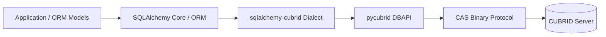
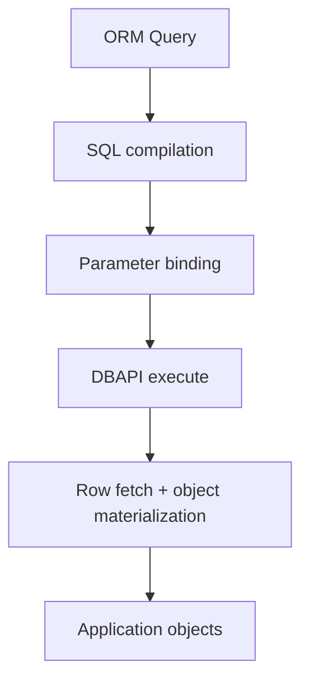
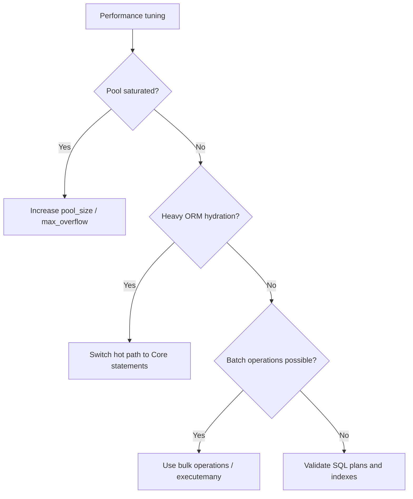

# 성능 가이드 (한국어)

> 🌐 [PERFORMANCE.md](https://github.com/cubrid-lab/sqlalchemy-cubrid/blob/main/docs/PERFORMANCE.md)의 번역입니다. 영어 원문이 표준이며, CI가 영어 원문과의 구조 일치를 검사합니다.

이 가이드는 애플리케이션이 `sqlalchemy-cubrid`를 사용할 때 시간이 어디에 쓰이는지,
흔한 작업을 빠르게 유지하는 방법, 그리고 자신의 머신에서 방언을 측정하는 방법을
설명합니다. 벤치마크 수치는 게시하지 않습니다. 드라이버와 데이터베이스를 넘나드는
재현 가능한 성능 실험은
[cubrid-benchmark](https://github.com/cubrid-lab/cubrid-benchmark)가 담당합니다.

---

## 목차

- [개요](#개요)
- [성능 특성](#성능-특성)
- [최적화 팁](#최적화-팁)
- [알려진 제한 사항](#알려진-제한-사항)
- [로컬에서 측정하기](#로컬에서-측정하기)

---

## 개요

`sqlalchemy-cubrid`는 CUBRID Python 드라이버 위에 SQLAlchemy Core/ORM 동작을 얹습니다.





---

## 성능 특성

- 방언은 드라이버의 전송 동작과 CAS 프로토콜의 왕복 비용을 그대로 물려받습니다.
  커밋하는 단일 행 쓰기에서는 서버 왕복과 커밋이 경과 시간의 대부분을 차지하고,
  읽기에서는 SQLAlchemy와 ORM 계층도 측정 가능한 비중을 더합니다.
- SQL 컴파일은 빠르지만 비용이 없지는 않습니다. SQLAlchemy의 문 캐시(기본값으로
  켜짐)는 컴파일된 문을 재사용하므로 같은 형태의 문을 반복하면 컴파일을 건너뜁니다.
  캐시를 끄면(`execution_options(compiled_cache=None)` 또는 엔진의
  `query_cache_size=0`) 매 실행마다 컴파일 비용이 더해집니다.
- ORM은 Core나 raw DB-API 사용에 비해 아이덴티티 맵과 객체 구체화 비용을 더하며,
  읽어 오는 행이 많을수록 차이가 커집니다.
- 파라미터 목록을 넘기는 Core와 ORM 대량 INSERT는 SQLAlchemy의
  insertmanyvalues 기능을 사용합니다. 행마다 문 하나를 보내는 대신 여러 행을 담은
  `INSERT ... VALUES` 문 몇 개를 보냅니다. 타입에 `bind_expression()`이 있는 열로의
  INSERT는 드라이버의 `executemany()`로 대체됩니다.
- pycubrid(동기와 비동기)에서는 Core UPDATE와 DELETE 파라미터 목록이 드라이버의
  `executemany()`를 거치므로 raw `executemany()` 호출과 비용이 거의 같습니다.
  CUBRIDdb는 다릅니다. 알려진 제한 사항을 참고하세요.
- 2026-10-12에 방언을 프로파일링한 결과(sqlalchemy-cubrid 1.11.0, pycubrid
  1.12.0, CUBRID 11.4) 방언 고유의 병목은 발견되지 않았습니다. 방언 자체 모듈이
  차지한 요청 시간 비중은 무시할 만했고, 대부분의 시간은 SQLAlchemy, 드라이버,
  서버 응답 대기에 쓰였습니다. 다른 버전에 이 결과를 적용하기 전에 다시 측정하세요.

---

## 최적화 팁

- 풀링을 명시적으로 구성하고(예: `pool_size`, `max_overflow`,
  `pool_pre_ping=True`) 동시에 일하는 워커 수에 맞게 풀 크기를 정하세요.
- 문 캐시를 켜 두고, SQLAlchemy가 컴파일된 형태를 재사용할 수 있도록 호출마다
  형태가 바뀌지 않는 문을 선호하세요.
- 여러 행은 한 번의 호출로 보내세요. 행마다 문을 하나씩 보내는 대신 Core
  `insert()`에 파라미터 딕셔너리 목록을 넘기거나 ORM 대량 INSERT/UPDATE를
  사용하세요.
- 트랜잭션을 명시적으로 유지하고 관련된 쓰기를 묶으세요. 커밋마다 서버 왕복이
  한 번 듭니다.
- ORM 객체가 필요 없으면 Core를 사용하거나 필요한 열만 읽어 오세요.



---

## 알려진 제한 사항

- **CUBRIDdb와 스레드.** CUBRIDdb C 확장(cubrid-python v11.3.0.51 소스에서
  확인했으며 `Py_BEGIN_ALLOW_THREADS`가 없음, 9.3.0 계열은 검증되지 않음)은 서버 왕복 동안 Python의
  전역 인터프리터 잠금(GIL)을 쥐고 있으므로, 한 프로세스의 여러 스레드가 이
  드라이버로 쿼리를 병렬 실행하지 못합니다. 2026-10-13에 cubrid-python v11.3.0.51
  빌드로 측정했을 때 스레드 4개나 8개로도 처리량이 늘지 않았습니다. 멀티스레드
  애플리케이션은 pycubrid를 사용하세요.
- **CUBRIDdb의 배치 UPDATE와 DELETE.** CUBRIDdb 드라이버에서 방언은 Core
  UPDATE/DELETE 파라미터 목록을 행마다 `execute()` 한 번으로 보냅니다. 이
  드라이버의 `executemany()`는 `None`을 바인딩하지 않고(해당 행이 이전 행의 값을
  조용히 재사용함) `rowcount`가 마지막 행만 보고하기 때문입니다. 행마다 서버 왕복이
  따로 일어나며, 이 경로는 pycubrid의 배치나 prepared 경로를 사용할 수 없습니다.
- **Prepared 배치는 기본값이 아닙니다.** pycubrid에는 로컬 측정에서 큰 배치가 더
  빨랐던 opt-in `executemany(..., prepared=True)`가 있지만, 받아들이는 값의 범위가
  더 좁고 `WITH`로 시작하는 문을 거부합니다. 방언은 드라이버의 기본 배치 경로를
  유지합니다.
- **리플렉션은 테이블마다 여러 문을 보냅니다.** 테이블의 열, 키, 인덱스, 제약
  조건을 리플렉션하면 CUBRID 카탈로그 쿼리가 여러 번 실행되므로, 큰 스키마에서는
  필요한 테이블만 리플렉션하세요.
- **비동기는 브리지를 더합니다.** `cubrid+aiopycubrid://`는 SQLAlchemy의 비동기
  API를 이벤트 루프 브리지로 실행하므로, 연결 하나에서 동기 드라이버보다 문마다
  약간의 비용이 더해집니다.

---

## 로컬에서 측정하기

이 저장소의 스크립트 세 개가 자신의 머신에서 방언을 측정합니다. 이 스크립트들은
방언 작업을 위한 디버깅 도구이지 성능 게이트가 아닙니다. CI는 이들을 서버에 대해
실행하지 않으며, 수치는 같은 호스트, 같은 CUBRID 서버, 같은 패키지 버전에서 잰
경우에만 비교할 수 있습니다. 개발 설치(`make install`, `bench_dialect_baseline.py`의 `cubrid://` 경로는
`[cubrid]` extra도 필요)를 한 체크아웃에서 실행하세요. CUBRID에 연결하는 두 스크립트는 자신의 테이블(`bench_users`와
`bench_dialect_baseline`)을 만들고 삭제하므로, `make docker-up`이 시작하는 것과
같은 일회용 테스트 데이터베이스를 가리키게 하세요.

### 컴파일 시간 측정

`scripts/bench_compile.py`는 서버 없이 방언의 SQL 컴파일 시간(LIMIT/OFFSET이 있는
SELECT, `INSERT ... ON DUPLICATE KEY UPDATE`, 단순 INSERT,
`SELECT ... FOR UPDATE`)을 잽니다:

```bash
python scripts/bench_compile.py --iterations 10000
```

### ORM 프로파일

`scripts/profile_orm.py`는 단일 행 ORM CRUD 루프, 대량 삽입, 조회를 `cProfile`
아래에서 실행하고, 시간을 방언, SQLAlchemy, 드라이버로 나누어 JSON 보고서를
씁니다:

```bash
python scripts/profile_orm.py \
    --dsn cubrid+pycubrid://dba@localhost:33000/testdb --output profile_orm_report.json
```

### raw 드라이버, Core, ORM 기준 측정

`scripts/bench_dialect_baseline.py`는 같은 작업을 raw 드라이버, SQLAlchemy
Core(문 캐시를 켠 경우와 끈 경우), ORM으로 한 테이블에서 여러 시행에 걸쳐 실행하고
각 결과를 검사합니다. 작업은 기본 키로 한 행을 읽는 SELECT, 시드된 모든 행 조회,
배치 INSERT/UPDATE/DELETE(pycubrid의 prepared 배치 변형 포함), 문 개수를 함께
기록하는 리플렉션, 그리고 `--concurrency`를 주면 동시 연결입니다.
`cubrid+pycubrid://`, `cubrid://`(CUBRIDdb), `cubrid+aiopycubrid://` URL을
받습니다. JSON 보고서에는 환경, 패키지 버전, 비밀번호를 뺀 연결 대상, 스크립트의
SHA-256이 기록됩니다:

```bash
python scripts/bench_dialect_baseline.py \
    --dsn cubrid+pycubrid://dba@localhost:33000/testdb \
    --trials 5 --concurrency 1,4,8 --output bench_dialect_baseline.json
```

작업 크기(`--rows`, `--iterations`, `--batch` 등)는
`python scripts/bench_dialect_baseline.py --help`로 확인하세요.

### 드라이버 간 실험

다른 드라이버나 데이터베이스와의 비교, 그리고 게시하거나 다른 사람이 반복할
결과는 CUBRID 드라이버의 재현 가능한 성능 실험을 담당하는
[cubrid-benchmark](https://github.com/cubrid-lab/cubrid-benchmark)에 두세요.
